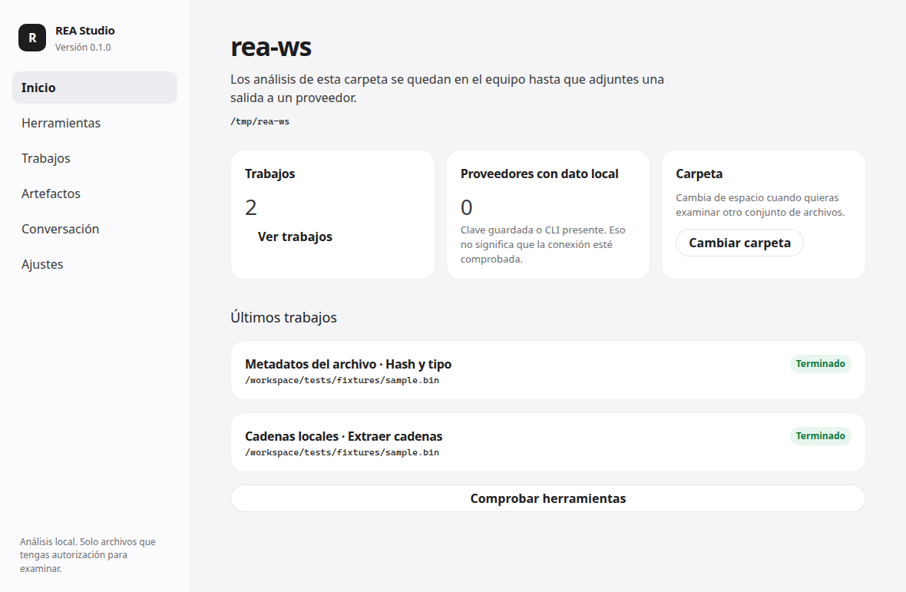
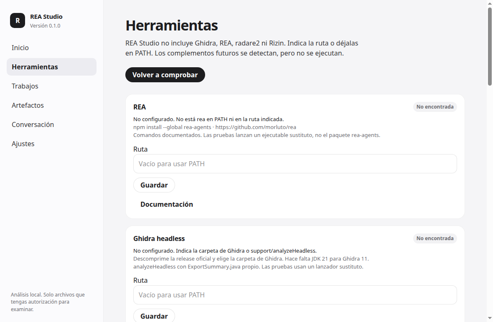
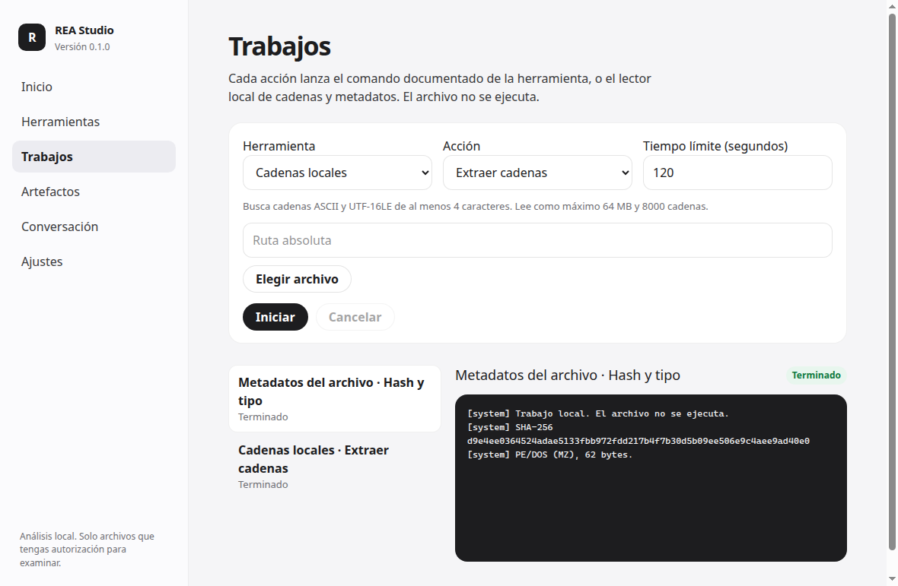
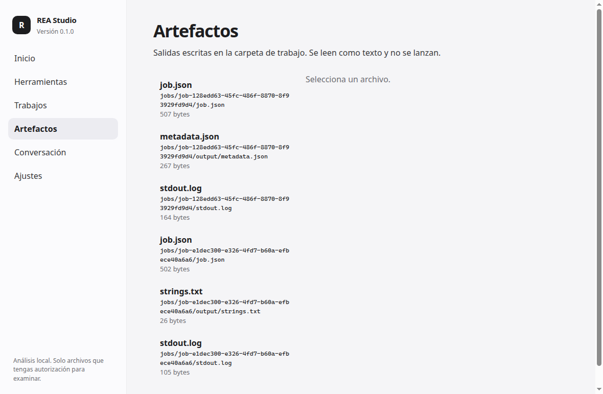
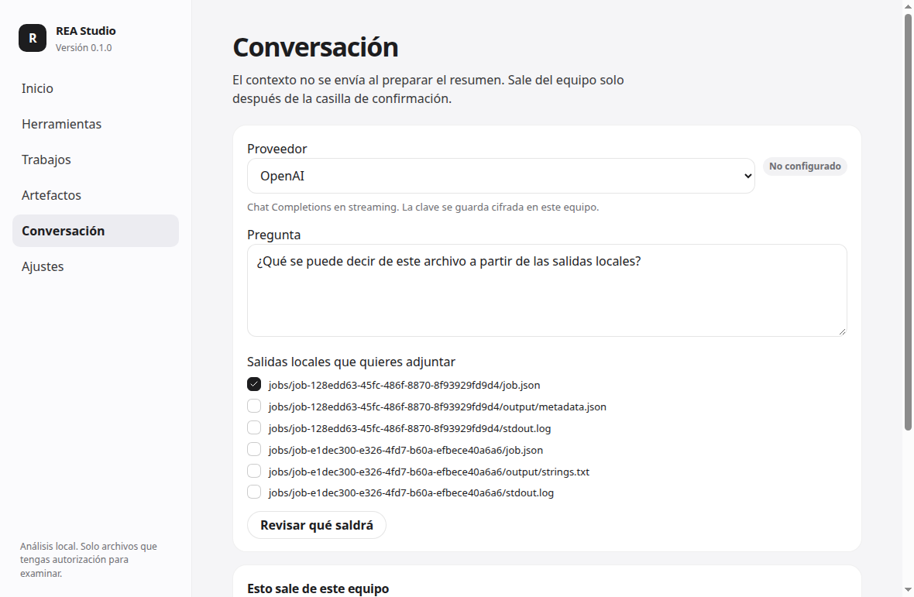
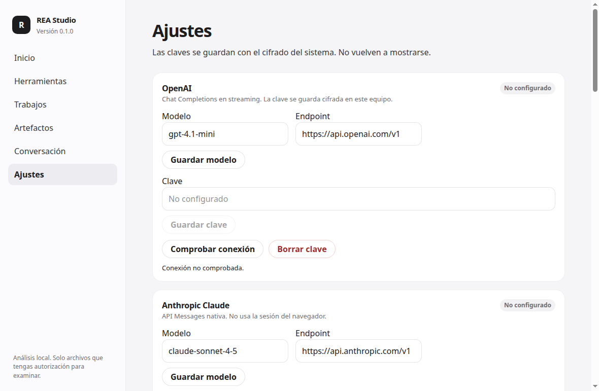

# REA Studio

REA Studio 0.1.0 es una aplicación de escritorio para examinar archivos en local. Lanza comandos reales de REA y de Ghidra headless, puede usar radare2 o Rizin si están instalados, y lee cadenas y metadatos sin programas extra. La conversación con un modelo solo sale del equipo después de mostrar qué texto se va a enviar y de marcar la casilla.

No ejecuta el binario analizado, no pide privilegios de administrador y no desactiva protecciones del sistema.

## Interfaz

Capturas hechas en Linux, sobre un análisis local real de `tests/fixtures/sample.bin`. En ese equipo no estaban REA, Ghidra ni claves de API: la interfaz lo dice, no simula que estén conectados. El registro muestra el SHA-256 y la marca `PE/DOS (MZ)`.













## Aviso

Usa la aplicación solo con binarios y código que tengas autorización para estudiar.

## Matriz de compatibilidad

| Pieza | Estado en 0.1.0 | Cómo se usa | Coste |
| --- | --- | --- | --- |
| Cadenas y metadatos | Implementado y cubierto por pruebas en este repositorio | Código local. No ejecuta el archivo | Ninguno |
| REA (`rea-agents`) | Adaptador implementado. Los comandos coinciden con la documentación de [morluto/rea](https://github.com/morluto/rea/blob/main/docs/cli.md). Las pruebas lanzan un ejecutable sustituto, no el paquete npm | `analyze-javascript-application`, `analyze`, `providers`, `capabilities`, `doctor` e inspecciones estáticas (`inspect-go-binary`, `inspect-pe-imports`, `inspect-pe-certificates`, `inspect-elf-notes`, `inspect-rust-binary`, `inspect-managed-artifact`, `inspect-python-pyc`) | La herramienta es MIT. Algunos proveedores nativos de REA son aparte |
| Ghidra headless | Adaptador implementado. `analyzeHeadless -import` más `ExportSummary.java`, propio de esta app. Prueba con un lanzador sustituto. Ghidra real no estaba instalado en el entorno de build | Proyecto aislado por trabajo, `-deleteProject`, tiempo límite por archivo. Hace falta JDK 21 para Ghidra 11 | Ghidra es Apache-2.0. El JDK es aparte |
| radare2 | Implementado: `rabin2 -IijES -j` y `r2 -q -c "aa; afl; q"`. Sin `ood` ni `dc`. No se ejecutó el binario oficial aquí | Instalación externa | LGPL-3.0 |
| Rizin | Implementado: `rz-bin` y `rizin -q -c "aa; afl; q"`. Misma reserva | Instalación externa | LGPL-3.0 |
| IDA, Binary Ninja, Hopper, JADX | Futuro. Si el ejecutable está en PATH se indica, y no se lanza | Ninguna | — |
| OpenAI API | Implementado. `POST /v1/chat/completions` con `stream: true`. Comprobación: `GET /v1/models` | Clave en el almacén cifrado. Modelo y endpoint configurables. Ejemplo: `gpt-4.1-mini` | La API se factura. Esta build no hizo llamadas de pago |
| Anthropic API | Implementado. `POST /v1/messages` con `stream: true` y cabecera `anthropic-version: 2023-06-01` | Ejemplo: `claude-sonnet-4-5` | La API se factura |
| xAI Grok | Implementado por API compatible con Chat Completions en `https://api.x.ai/v1`. No hay CLI de Grok en esta versión | Ejemplo: `grok-4` | La API se factura |
| Gemini API | Implementado. `streamGenerateContent?alt=sse` y cabecera `x-goog-api-key` (la clave no va en la URL) | Ejemplo: `gemini-2.5-flash` | La API se factura |
| Endpoint OpenAI compatible | Implementado. Sirve para Ollama u otro servidor local. HTTP solo si el host es localhost | Ejemplo: `http://127.0.0.1:11434/v1` | Según el servidor. Local no sale de la máquina, pero igual hay que confirmar el envío |
| Codex CLI | Implementado. `codex exec --json --ephemeral --sandbox read-only`. Sin `--yolo` | Usa el inicio de sesión que ya tengas en Codex. La comprobación solo ejecuta `--version` para no generar un cargo | Suscripción o API de ChatGPT, según tu cuenta |
| Claude Code | Implementado. `claude -p` con `--safe-mode`, `--permission-mode plan`, `--tools ""` y `--max-turns 1`. No usa `--bare`, porque ese modo no reutiliza la sesión normal | La comprobación es `--version`. El mensaje sí puede tener coste | Suscripción o API de Anthropic |
| Gemini CLI | Implementado. `gemini -p --approval-mode plan --skip-trust --output-format stream-json` | Igual: versión sin enviar un prompt de prueba | Cuenta de Google |

Si falta la clave o el ejecutable, la interfaz dice **No configurado**. No hay un estado «conectado» hasta una comprobación real. Las pruebas de protocolo usan respuestas SSE simuladas y lo dicen en el nombre del test. La autenticación en vivo contra OpenAI, Anthropic, xAI y Google **no se ha ejecutado** en esta build.

Los identificadores de modelo son ejemplos editables. Si la cuenta no tiene ese modelo, se muestra el error del proveedor.

## Qué hace la primera versión

- Carpeta de trabajo, con registros y resúmenes dentro de `jobs/`.
- Comprobación de herramientas y rutas configurables.
- Trabajos con registro en vivo, cancelación y tiempo límite.
- Visor de artefactos de texto. Los binarios no se previsualizan ni se ejecutan.
- Conversación con resumen de lo que saldría del equipo y casilla obligatoria.
- Ajustes de modelo, endpoint y clave. Las claves pasan por `safeStorage`. Si el cifrado del sistema no está disponible, no se guardan en texto plano.

## Instalación de la aplicación

El instalador de 0.1.0 es NSIS x64 para Windows: `REA-Studio-0.1.0-win-x64.exe`, junto con `SHA256SUMS` e `INSTALL-VALIDATION.txt`. Lo genera `.github/workflows/release-windows.yml` en `windows-latest` al etiquetar `v0.1.0`. La publicación es una **vista previa** (`prerelease`). El instalador no va firmado y Windows SmartScreen puede avisar.

El job separa tres niveles. No los conviertas en una sola frase de «instalador verificado»:

1. **Build.** `npm run typecheck`, `npm test` y `npm run dist:win` en `windows-latest`. El `.exe` tiene que pesar más de 40 MB y empezar por `MZ`.
2. **Instalación.** El NSIS se ejecuta en silencio (`/S`) sobre un directorio del runner. Cuenta como instalación silenciosa si el proceso sale con 0 y el directorio contiene el ejecutable de la aplicación, también con marca `MZ`.
3. **Arranque.** Ese ejecutable se lanza con `REA_STUDIO_SMOKE=1`. El proceso principal escribe un marcador al llegar a `app.ready` y crear la ventana, y después termina. Eso no recorre la interfaz, no instala REA ni Ghidra y no llama a APIs de pago. Si el runner no abre el proceso a la primera, el job reintenta con `--disable-gpu --no-sandbox` y lo anota en `launch_args`. Ese reintento es una limitación del runner, no el arranque normal en un escritorio.

El archivo `INSTALL-VALIDATION.txt` de la release dice qué nivel se alcanzó en esa ejecución. Si `launch_status` no es `main_process_ready`, el arranque no está comprobado.

Una compilación cruzada anterior en Linux produjo un NSIS de 119 MB con SHA-256 `455f1073788c9685067d7463e32a5de63bf20cf2fd02e27bf4ccba4e5dd3e801`. No es esta release: Wine no llegó a instalar la aplicación (salida 2) y ese archivo no está en git.

## Instalación de herramientas

La aplicación y las herramientas son cosas distintas.

- REA: Node.js y `npm install --global rea-agents`. Guía: https://github.com/morluto/rea
- Ghidra: ZIP oficial desde https://github.com/NationalSecurityAgency/ghidra o https://ghidra-sre.org/ . En Herramientas, elige la carpeta de instalación o `support/analyzeHeadless.bat`.
- Java: JDK 21, por ejemplo Temurin https://adoptium.net/temurin/releases/?version=21
- radare2: https://github.com/radareorg/radare2
- Rizin: https://rizin.re/
- Codex CLI: https://learn.chatgpt.com/docs/non-interactive-mode
- Claude Code: https://code.claude.com/docs/en/headless
- Gemini CLI: https://github.com/google-gemini/gemini-cli

En Windows, un shim `.cmd` o `.bat` se lanza con `cmd.exe /d /s /c` y argumentos citados. Si la ruta contiene `& | < > ^ % !` o comillas, el trabajo se rechaza en lugar de interpretarse como una orden.

## Configuración

Ejemplo de lo que se guarda en la configuración, sin claves:

```json
{
  "providers": {
    "openai": { "model": "gpt-4.1-mini", "endpoint": "https://api.openai.com/v1" },
    "anthropic": { "model": "claude-sonnet-4-5", "endpoint": "https://api.anthropic.com/v1" },
    "xai": { "model": "grok-4", "endpoint": "https://api.x.ai/v1" },
    "gemini": { "model": "gemini-2.5-flash", "endpoint": "https://generativelanguage.googleapis.com/v1beta" },
    "compatible": { "model": "llama3.2", "endpoint": "http://127.0.0.1:11434/v1" }
  }
}
```

La clave se escribe en el almacén del sistema operativo. No la pongas en este JSON, en el chat exportado ni en un commit. Un endpoint público tiene que ser `https`. `http` solo se acepta en localhost.

## Desarrollo

Hace falta Node.js 22.

```bash
npm ci
npm run typecheck
npm test
npm run dev
```

`npm run dev` abre Electron y sirve la interfaz en `http://127.0.0.1:43123`.

```bash
npm run build
npm run dist:win
```

`dist:win` usa electron-builder con NSIS x64 y `--publish never`. Si el checkout está en una etiqueta, electron-builder 26 intenta publicar solo y falla sin `GH_TOKEN`; la release la sube el workflow, no electron-builder. En Windows no hace falta Wine. En Linux, electron-builder ejecuta un stub NSIS de 32 bits para cerrar el instalador: hace falta `wine` y `wine32`. El bundle Wine 11 (`toolsets.wine` 1.0.1) falló en esta imagen con `ntdll.dll` `c0000135`. `CSC_IDENTITY_AUTO_DISCOVERY=false` evita buscar un certificado. El instalador no está firmado.

## Pruebas

`npm test` cubre:

- argumentos de REA, Ghidra, radare2 y Rizin
- rutas que salen del espacio de trabajo, bytes nulos y metacaracteres de `cmd.exe`
- un argumento con `&` y `$(...)` pasado sin shell
- ejecución de sustitutos de `rea` y `analyzeHeadless` (en Windows el sustituto es un `.js` lanzado con `node.exe`, porque un shebang no es un ejecutable)
- cadenas y metadatos sobre `tests/fixtures/sample.bin`
- cancelación y tiempo límite
- redacción de una clave conocida y rechazo a guardarla en claro
- SSE simulado de OpenAI, Anthropic y Gemini
- la casilla de envío a un proveedor
- un humo de la interfaz: aviso de uso y estado «No configurado»

No cubre una sesión real de Ghidra, REA, radare2, Rizin ni de las APIs de pago. El arranque `REA_STUDIO_SMOKE=1` del workflow de Windows solo comprueba que el ejecutable instalado llega a `app.ready`.

## Limitaciones

- v0.1.0 no es una suite completa. El registro de complementos deja sitio para más herramientas, sin prometerlas.
- `rea analyze` puede elegir un proveedor que tengas configurado dentro de REA. Esta aplicación no añade flags de instrumentación ni de ejecución.
- El script de Ghidra lista como máximo 200 funciones. No se compiló contra `ghidra.jar` en esta build.
- Los CLI pueden seguir enviando el texto a su proveedor aunque el sandbox sea de solo lectura. Por eso la casilla es obligatoria.
- La comprobación de un CLI no inicia sesión y no envía un prompt.
- `npm audit` marcó 6 avisos moderados en dependencias de empaquetado. Ver `THIRD_PARTY_NOTICES.md`.
- No hay cuenta de servicio ni clave en este repositorio. No se hizo una llamada de pago durante la construcción.

## Licencia

MIT. Ver `LICENSE` y `THIRD_PARTY_NOTICES.md`.
